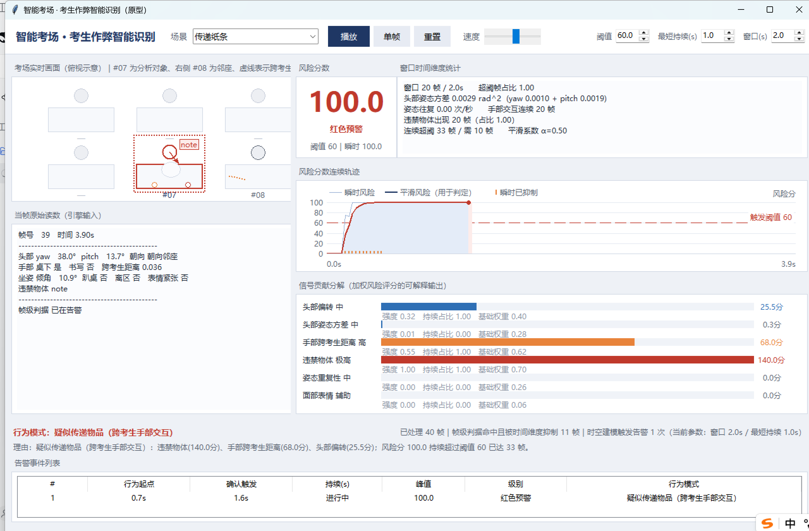
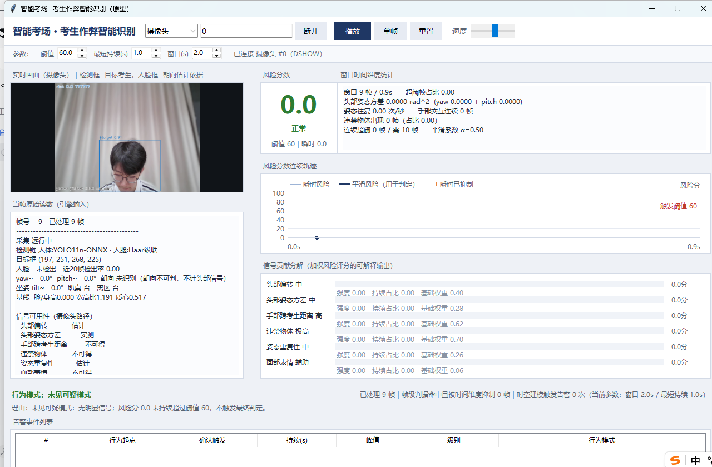

# 考生作弊智能识别（cheatdetect）

> AI 识别作弊的核心逻辑**不是**判断“某个动作本身是否作弊”，
> 而是判断**动作序列是否构成了“获取或传递答案”的行为模式**。
> 单个动作（如转头、低头）可能只是正常疲劳调整，
> 只有结合**持续时间、频率和上下文**才能做出有意义的判定。

本目录是《考生作弊智能识别核心逻辑》项目书的配套**可运行 Python 原型**
与**演示测试**，实现“加权风险分数 + 滑动时间窗口 + 持续超阈才触发”的
完整判定链路。

---

## 一、快速开始

### 方式一：一键运行（推荐）

在文件资源管理器里**双击 `运行演示.bat`**（命令行演示 + 自检）；
或者**双击 `启动界面.bat`**（打开巡考监控界面）。也可以在命令行里输入它们的名字：

```bat
运行演示.bat
启动界面.bat
```

> ⚠️ **不要**写成 `python 运行演示.bat`。
> `.bat` 是 Windows 批处理脚本，必须交给 `cmd` 执行；
> 用 `python` 运行它，Python 会把批处理语法当 Python 代码解析并报语法错误。

### 方式二：直接运行 Python 脚本

```bat
:: 巡考监控界面（图形界面）
python 界面.py

:: 演示（八节：判定链路 / 权重 / 瞬时抑制 / 持续触发 / 边界 / 仿真 / 可解释 / 结论）
python 演示.py
python 演示.py --trials 200 --seed 2026

:: 自检（48 项）
python 自检.py

:: 单元测试（47 项，标准库 unittest，无第三方依赖）
python -m unittest discover -s tests -v
```

**无第三方依赖**：全部使用 Python 标准库（界面用 Tkinter），Python 3.8+ 即可运行。

---

## 二、巡考监控界面



`python 界面.py` 或双击 `启动界面.bat` 打开。界面**直接驱动 cheatdetect 引擎的真实输出**，
没有任何为演示而设的假数据；画面元素全部由当帧 `FrameFeatures` 绘制，所见即引擎输入。

| 区域 | 内容 |
| --- | --- |
| 顶部工具栏 | 场景选择、播放/暂停/单帧/重置、速度，以及**可实时调节**的阈值 / 最短持续 / 窗口 |
| 考场实时画面 | 俯视示意：#07 为分析对象（蓝框，告警时转红并加红虚线框）、右侧 #08 为邻座；头部圆点+视线方向（朝向决定颜色）、坐姿倾角、双手位置（桌下/桌面、跨考生靠近）、违禁物体角标 |
| 当帧原始读数 | yaw / pitch / 朝向 / 手部状态 / 跨考生距离 / 坐姿 / 表情 / 违禁物体 / 帧级判据 |
| 风险分数 | 大号分数 + 分级（正常 / 关注 / 橙色预警 / 红色预警），并显示瞬时值 |
| 窗口时间维度统计 | 窗口长度、超阈帧占比、头部姿态方差、姿态往复频率、手部交互连续帧数、物体出现占比、连续超阈帧数 |
| 风险分数连续轨迹 | 瞬时风险（细线）、平滑风险（粗线，用于判定）、阈值虚线、**告警区底色**、底部橙色刻度＝**被时间维度抑制的帧级误报**；图例在绘图区上方，不压曲线 |
| 信号贡献分解 | 六个信号的彩条贡献分 + 强度 / 持续占比 / 基础权重（可解释输出） |
| 行为模式与理由 | 模式标签、可解释理由文本、以及"帧级判据命中且被抑制 N 帧 / 时空建模触发告警 M 次"的对比 |
| 告警事件列表 | 行为起点、确认触发、持续时长（未结束显示"进行中"）、峰值、级别、模式 |

**用法建议**：

- 选 `传递纸条` / `使用手机` 等场景点播放，看风险轨迹如何**持续超阈后才触发**，底部橙色刻度就是被抑制的帧级误报。
- 选 `伸懒腰` / `调整坐姿` / `短暂分心`，风险会冲高但不触发 —— 这就是"瞬时动作被自动抑制"。
- 把 `最短持续(s)` 从 1.0 调到 0.3，再重放同一场景，可直观看到**误报随闸门放松而增加**；调大则漏报风险上升。
- 把 `阈值` 调低，同样能看到告警提前、误报增多 —— 参数与误报/漏报的权衡可直接观察。

> 界面底部常驻声明：所驱动的均为**合成场景**，数值是算法逻辑验证结果，
> **不是**真实考场实测数据。

**已知限制**：界面为 DPI 非感知（Tk 默认），在高分屏（如 200% 缩放）上会由
Windows 统一位图缩放 —— 布局比例正确，文字略软。若需像素级清晰，可在
`界面.py` 顶部创建窗口前调用 `ctypes.windll.shcore.SetProcessDpiAwareness(1)`，
并按 DPI 因子同步缩放画布尺寸与坐标。



### 连接摄像头 / 视频文件 / 网络流

工具栏左侧「数据源」选 **摄像头 / 视频文件 / 网络流**，填入序号或地址，点**连接**：

| 数据源 | 填入内容 | 示例 |
| --- | --- | --- |
| 摄像头 | 设备序号 | `0`、`1` |
| 视频文件 | 完整路径（可含中文，程序会自动规避 OpenCV 的路径限制） | `D:\videos\room1.mp4` |
| 网络流 | rtsp/http 地址 | `rtsp://192.168.1.64:554/Streaming/Channels/101` |

连接后：左侧显示**实时画面**（检测框=目标考生，人脸框=朝向估计依据），
右侧风险分、轨迹、贡献分解、告警事件表照常实时更新。参数改动会即时重建引擎。

**依赖**：摄像头/视频接入需要 `opencv-python`（`pip install opencv-python`）。
未安装时程序**不会崩溃**，只是数据源里会明确提示缺少依赖，合成场景照常可用。
人体检测优先用 YOLO11n ONNX（`onnxruntime` + 工程内已有的 `yolo11n.onnx`），
找不到模型时自动退回 OpenCV 自带的 HOG+SVM。

#### 摄像头路径的信号能力（**必须如实了解**）

摄像头路径只使用**无需额外下载**的模型（YOLO11n 人体检测 + Haar 人脸），
因此**不是所有信号都能拿到**。界面「当帧原始读数」里会逐项标注：

| 信号 | 摄像头路径 | 依据 |
| --- | --- | --- |
| 头部偏转 | **估计** | 人脸框相对人体框的水平偏移 → 左右转头 |
| 头部姿态方差 | **实测** | 由上述估计值在滑动窗口内计算（非单帧量） |
| 姿态重复性 | **估计** | 人体框宽高比 / 质心相对自建基线的偏离 |
| 手部跨考生距离 | **不可得** | 需手部关键点，须接姿态模型（YOLO-pose 等） |
| 违禁物体 | **不可得** | 需专用物体模型，建议接《06_智能安检与手机作弊器材检测》 |
| 面部表情 | **不可得** | 需表情模型 |

**不可得的信号不会被编造**：它们保持中性值（跨考生距离为 `None`、物体为空），
贡献恒为 0，界面上标注为「不可得」。也就是说，摄像头路径能识别
**旁窥、坐姿异常、东张西望**这类头部与姿态模式，
但**无法识别传递物品与使用手机** —— 后者需要接姿态模型与物体模型。

#### 几个必须知道的行为

- **低头看自己试卷时不产生头部信号**：Haar 正脸级联检测不到低头姿态，
  此时朝向记为「不可判」。这是**正确**行为（低头是正常答题姿态，不该报警），
  而不是缺陷；但它同时意味着：若考生始终低头后突然转头而人脸仍检不出，
  **可能漏报**。要稳健识别转头，建议接入姿态模型或更强的人脸检测
  （工程内 `01_人脸识别与身份核对` 已带 insightface 的 `buffalo_l` 模型包）。
- **人脸"突然消失"才算转头**：人脸此前稳定可见（近 20 帧检出率 ≥0.6）而本帧
  检不到，才推断为转头离开；若人脸一直检不到（距离远、逆光、背对），
  一律记为「朝向不可判」，**不**推断为转头 —— 检测能力边界不等于观测到异常。
- **帧率跟不上会被如实提示**：界面显示「实测 X fps（标称 10）」，低于标称 60%
  时会警告「时间窗口会被拉长，判定偏迟钝」。因为引擎按帧数换算时间，
  实际速率过低会让 2 秒窗口被拉长。
- **中文用户名/路径已自动规避**：OpenCV 的 `VideoCapture`/`CascadeClassifier`
  在中文路径下会静默失败，程序会自动把级联与视频文件暂存到纯 ASCII 的
  `%ProgramData%\cheatdetect\` 再加载（本机用户名即为中文，此处已实测）。

---

**中文显示说明**：脚本不对输出编码做任何改动，交给 Python 默认行为处理 ——
输出到控制台时用 `WriteConsoleW` 直接写 Unicode，输出被重定向时用系统区域编码
（简体中文 Windows 即 GBK），与 `运行演示.bat` 自身的输出保持一致。
需要强制 UTF-8 输出时，在外部设置 `PYTHONIOENCODING=utf-8` 即可。
`运行演示.bat` 为 **GBK(cp936) 编码**（前两行是纯 ASCII 的 `chcp 936`，
保证在任意代码页下都能正确解析），这是 Windows 中文环境下批处理引用中文
文件名的必要做法。

---

## 三、判定链路

```
单帧多模态特征（头部姿态 / 手部关键点 / 坐姿 / 物体 / 表情）
  → 滑动时间窗口（默认 2.0s / 20 帧）聚合多模态特征
  → 各信号强度 × 有效权重（基础权重 × 持续性增益）加权求和
  → 指数平滑得到风险分数的连续轨迹
  → 风险分数持续超过阈值（默认 ≥1.0s / 10 帧）才触发最终判定
  → 单次瞬时动作被自动抑制
```

---

## 四、可量化动作界定维度（信号定义）

| 信号 | 对应项目书维度 | 判定依据 | 权重方向 |
| --- | --- | --- | --- |
| `head_deviation` 头部偏转 | 头部与视线姿态 | 头部偏离考试区域且 yaw/pitch 超阈值；`on_paper` 恒为 0 | 中 |
| `head_variance` 头部姿态方差 | 头部与视线姿态 | 窗口内 yaw/pitch 方差达到阈值（rad^2） | 中 |
| `hand_interaction` 手部跨考生距离 | 手部与肢体交互 | 桌面下方手部关键点与邻座距离小于阈值，且**连续 ≥3 帧** | 高 |
| `prohibited_object` 违禁物体 | 动作之外的辅助信号 | 检出手机/纸条等，按危险度与置信度取强度 | 极高 |
| `posture_repetition` 姿态重复性 | 姿态与持续性异常 | 往复频率（带滞回计数）+ 坐姿偏离/趴桌/离区 | 中 |
| `expression_aux` 面部表情 | 动作之外的辅助信号 | 紧张与中性交替变化（辅助项） | 辅助 |

**关键防误报设计**：`head_deviation` 只在朝向被判为**离开考试区域**时计分。
因此“长时间低头看自己试卷”不会产生任何作弊信号 —— 它有专门的回归测试。

---

## 五、加权风险评分（非二值）

```
有效权重_i = 基础权重_i × (1 + 持续性增益 × 持续占比_i)
原始分     = Σ (有效权重_i × 强度_i)
风险分     = min(100, 100 × 原始分)
```

基础权重与阈值 60 的配合关系（默认参数）：

| 情形 | 得分 | 是否触发 |
| --- | --- | --- |
| 违禁物体满强度持续 | ≥70 | ✅ 触发（直接证据） |
| 手部跨考生交互满强度持续 | ≥62 | ✅ 触发 |
| 头部偏转满强度**且整个窗口持续** | 80 | ✅ 触发 |
| 头部偏转只出现一瞬（持续占比 0.15） | ≈37 | ❌ 抑制 |
| 头部姿态方差满强度持续 | 56 | ❌ 单独不触发（需叠加） |
| 姿态重复性满强度持续 | 52 | ❌ 单独不触发（需叠加） |
| 头部偏转 + 头部方差 | ≈100 | ✅ 触发 |

> **“持续时间”实现为两件事**：① 闸门（gate）—— 风险分数持续超阈
> `min_sustain_seconds` 才触发；② 增益（boost）—— 信号在窗口内的
> 持续占比提升其有效权重。两者共同保证“瞬时动作被自动抑制”。

---

## 六、行为模式识别（可解释输出）

判定“是什么模式”，供人工复核：

| 模式 | 触发条件 |
| --- | --- |
| 疑似使用/持有违禁物品 | 检出手机/纸条等 |
| 疑似传递物品（跨考生手部交互） | 检出物体**且**跨考生手部交互同时成立；或手部交互主导 |
| 疑似旁窥（转头获取答案） | 头部偏转主导 |
| 疑似东张西望/注意力显著涣散 | 头部姿态方差主导 |
| 疑似多动与坐姿异常 | 姿态重复性主导（且无更具体的头部/手部信号） |
| 疑似复合作弊行为模式 | 多项信号同时成立且无单一主导 |

每帧输出**贡献分解**（哪个信号贡献了多少分）、**持续占比**、
**窗口时间维度统计**与**中文理由文本**，直接作为巡考员复核依据。

---

## 七、演示测试结果（【注意】 合成数据仿真，非实测）

`python 演示.py` 的第六节输出，十二个合成场景 × N 次随机试验：

| 场景 | 真值 | 帧级基线 | 时空引擎 |
| --- | --- | --- | --- |
| 安静答题 / 长时间低头 / 揉眼托腮 | 正常 | 0% | 0% |
| 伸懒腰 / 调整坐姿 / 短暂分心 | 正常 | **100%** | **0%** |
| 反复旁窥 / 持续转头 / 传递纸条 | 作弊 | 100% | 100% |
| 使用手机 / 东张西望 / 多动转头 | 作弊 | 100% | 100% |
| **汇总** | | **误报 50.0%** | **误报 0.0%** |

瞬时抑制边界扫描（单次转头 yaw=50°）：

```
0.1~0.4s   触发率   0%   ← 瞬时动作被完全抑制
0.5s       触发率  78%
0.6~2.0s   触发率 100%
```

**边界样本（真值不可由画面判定，须人工复核）**：

- 反复看向后方（如**看挂钟**）：运动学上与旁窥相似 → 引擎会提示，
  必须由人工复核 —— 这是**有意**的行为，符合项目书“视线落点反复指向
  非考试区域即触发可疑信号”的口径。
- 极短促单次转头（0.4s）：低于实测可检出边界 → 引擎不提示，
  属漏报取舍。

---

## 八、目录结构

```
cheatdetect/
├── cheatdetect/              引擎包
│   ├── __init__.py           对外导出
│   ├── config.py             阈值、窗口、持续性增益等可量化参数
│   ├── features.py           帧级特征定义（头部/手部/坐姿/物体/表情）
│   ├── temporal.py           滑动窗口、方差、往复计数（带滞回）、持续判定
│   ├── signals.py            信号强度与持续占比提取 + 帧级判据
│   ├── scoring.py            加权风险评分、权重表、分级
│   ├── patterns.py           行为模式识别与可解释文本
│   ├── detector.py           主入口 CheatDetector
│   ├── simulate.py           合成场景、帧级基线、仿真评估、边界扫描
│   ├── videosource.py        帧源：摄像头 / 视频文件 / 网络流（含中文路径规避）
│   └── perception.py         感知层：YOLO11n 人体 + Haar 人脸 → FrameFeatures
├── tests/test_engine.py      47 项引擎单元测试
├── tests/test_camera.py      28 项摄像头/感知单元测试（打桩，不需要真摄像头）
├── 界面.py                    巡考监控界面（Tkinter，零第三方依赖）
├── 界面截图.png               界面截图（合成场景）
├── 界面截图_摄像头.png         界面截图（摄像头模式）
├── 启动界面.bat               一键打开界面
├── 演示.py                    八节完整演示
├── 自检.py                    48 项自检
├── 运行演示.bat               一键运行演示 + 自检
└── README.md
```

---

## 九、用在自己的视频上

引擎的输入是**逐帧结构化特征**（不依赖具体检测器），
因此可以接任意上游感知模块（YOLO-pose、头部姿态估计、
手部关键点检测、物体检测），或直接回放已有日志：

```python
from cheatdetect import CheatDetector, FrameFeatures, HeadPose, HandState, PostureState

det = CheatDetector()                     # 也可传入自定义 Config / SignalWeights

for i, det_frame in enumerate(your_perception_output):
    frame = FrameFeatures(
        frame_id=i,
        timestamp=det_frame.time,
        head=HeadPose(yaw_deg=det_frame.yaw, pitch_deg=det_frame.pitch,
                      relation=det_frame.relation),   # on_paper/off_area/toward_neighbor/toward_back
        hand=HandState(below_desk=det_frame.below_desk,
                       cross_distance=det_frame.neighbor_dist,
                       doing_write=det_frame.writing),
        posture=PostureState(tilt_deg=det_frame.tilt,
                             leaning_on_desk=det_frame.leaning,
                             left_area=det_frame.left_area),
        prohibited_objects=det_frame.objects,         # ["phone"] / [("note", 0.85)]
        expression_tense=det_frame.tense,
    )
    r = det.push(frame)
    if r.just_triggered:
        print(r.timestamp, r.level, r.pattern, r.risk)
        print(r.reason)                            # 给巡考员看的解释

det.finish()
print(det.summary())
print(det.event_dicts())                           # 告警事件清单（可入库）
```

---

## 十、重要声明

1. 本目录所有输出数值均来自**合成数据仿真**，用于验证算法逻辑
   是否按设计工作，**不是真实考场实测数据**，不得作为实测精度结论。
2. 项目书主文档中引用的“帧级误报率 15.2% → 4.3%、
   准确率 84.6% → 95.1%”为**外部引用值**，与本原型的仿真数值
   不是同一来源，不应互相替代或混淆。
3. 本系统只做**提示与留痕**，不做裁定。最终处置权在监考/巡考人员；
   “看挂钟”与“看邻座答案”这类画面不可区分的情形必须由人工复核。
4. 真实部署需遵守《个人信息保护法》《数据安全法》
   《人脸识别技术应用安全管理规定》的最小必要、目的限定与
   存储期限要求（见主项目书合规章节）。
