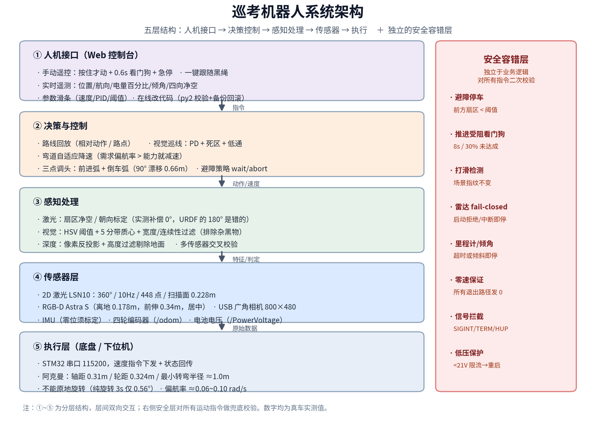

# 巡考机器人 · 技术方案

> 平台：Wheeltec 阿克曼小车（Jetson + STM32，ROS Melodic）
> 目标：教室/实验室场景的自动巡逻、打卡记录与视觉跟随
> 版本：2026-10-20　｜　文中数字除注明外均为**真车实测**

---

## 0. 一句话概括

在**不能原地转、最小转弯半径约 1m**的阿克曼底盘上，用「激光 + 视觉 + 里程计」做闭环，
实现**固定路线巡逻**与**跟随黑/白线**两种模式，并用一层独立的安全容错逻辑兜底
（避障、打滑、受阻、传感器失效、零速保证）。



---

## 1. 硬件与平台

| 项目 | 规格 | 说明 |
| --- | --- | --- |
| 底盘 | Wheeltec `senior_akm` | 前轮转向 + 后轮驱动 |
| 几何 | 轴距 0.31 m / 轮距 0.324 m / 车长 0.62 m / 宽 0.44 m | 影响转弯半径与避障余量 |
| 下位机 | STM32，串口 115200 | 收速度指令，回传轮速/IMU/电压 |
| 上位机 | Jetson（aarch64）+ Ubuntu 18.04 + ROS Melodic | 感知、决策、网页服务 |
| 激光雷达 | LSN10：360°、10 Hz、448 点 | 扫描面高 **0.228 m**，前伸 0.26 m |
| 相机 A | Orbbec Astra S（RGB-D） | 离地 0.178 m，前伸 0.34 m，**居中** |
| 相机 B | USB 广角 UVC（800×480@30） | 后加，用于更宽视野的巡线 |
| IMU | 板载陀螺 + 加速度 | 漂移约 0.6°/min，**必须标零位** |
| 编码器 | 四轮电机内置 | `/odom` 的唯一来源 |
| 电池 | 24 V 6 串锂电 | 满 25.2 V / 保护约 21.0 V |

---

## 2. 感知子系统

### 2.1 激光雷达

| 技术点 | 做法 | 实测结论 |
| --- | --- | --- |
| 扇区净空 | 360° 按角度分扇区取最近距离 | 用于避障门限、四向净空显示 |
| 朝向标定 | 深度相机剖面 × 雷达剖面做相关性 | **补偿角应为 0°**；URDF 写的 180° 会指向盲区（0 个有效回波） |
| 场景指纹 | 每帧压成 36 个扇区最小距离 | 用作「打滑检测」的依据 |
| 失效检测 | 启动无数据 → 拒绝启动；运行中断 1 s → 停车 | 防止"避障静默失效" |

### 2.2 视觉（巡线）

| 技术点 | 做法 |
| --- | --- |
| 颜色分离 | 白线：`S<30 且 V>230`；黑线：`V<90 且 S<90` |
| 结构化提取 | 画面切成 5 条带，每带取"细长段"的列质心 |
| 排除干扰 | 段宽 ≤45 px + 跨带 x 差 <65 px 才连成链 + 必须经过近端带 |
| 弯道估计 | 远带偏差 − 近带偏差 → 判断前方弯的急缓 |
| 控制 | PD（Kp 0.95 / Kd 0.30）+ 死区 0.05 + 低通 0.6 |
| 弯道降速 | 按"需求偏航率 = v×曲率"判断能力，急弯降到 0.055 m/s |

### 2.3 深度相机

- 像素反投影到相机系：`X=(u-cx)Z/fx, Y=(v-cy)Z/fy`
- **高度过滤**：只保留高于光轴 −12 cm 的点 → **剔除地面**（否则地板会被当成 0.4 m 障碍）
- 用途：障碍测距、雷达朝向交叉验证、抓图

---

## 3. 运动控制

| 技术点 | 做法 | 实测 |
| --- | --- | --- |
| 测距 | 里程计位移投影到"段起点航向" | 1.00 m 目标 → 0.984 m |
| 航向保持 | IMU 偏航闭环（非 odom） | 直线漂移从 −4.87° 降到 −0.12° |
| 转向闭环 | IMU 角度差 + P 控制 + 减速段 | 目标 20° → 17.94° |
| 三点调头 | 前进弧 45° + 倒车弧 45° | 合计 86°，净漂移 0.66 m |
| 速度规划 | 加速度限幅 + 剩余距离开方减速 | 无急停点头 |
| 弯道自适应 | 需求偏航率 vs 车能力 | 能力 ≈0.06~0.10 rad/s |

**两条硬约束（实测）**

1. **不能原地旋转**：纯旋转指令 3 s → 航向变化 0.56°、位移 0.000 m
2. **最小转弯半径 ≈1.0 m**：所以线的弯半径必须 ≥1.2 m，否则任何速度都会冲出去

---

## 4. 定位与误差

| 项 | 结论 |
| --- | --- |
| 定位来源 | 轮式里程计（相对）＋ IMU（航向） |
| odom 航向 | **高估约 16%** → 转向一律用 IMU |
| 打滑 | odom 会"空转"：实测卡住时虚走 1.3 m |
| IMU 零位 | 重启/搬车后原始读数会变（+5.5° → ~0°），**必须重标** |
| 升级路径 | 车上已有 `slam_karto`/`gmapping` + `amcl`/`move_base`，可做建图+定位纠偏 |

---

## 5. 安全与容错（核心设计）

| 机制 | 触发条件 | 动作 |
| --- | --- | --- |
| 避障停车 | 前扇区 < 阈值（默认 0.35 m） | 停车等待/中止 |
| 推进受阻看门狗 | 8 s 内未完成 30% 目标 | 停车（把 90 s 卡死缩到 8 s） |
| 打滑检测 | odom 走了 ≥0.25 m 但场景指纹不变 ×5 | 停车，记 `slip_suspected` |
| 雷达 fail-closed | 启动无 `/scan` / 运行中断 >1 s | 拒绝启动 / 立即停车 |
| 里程计超时 | >0.5 s 无 `/odom` | 停车 |
| 倾角保护 | 相对零位倾斜 >3° | 拒绝移动 |
| 急停 | 网页按钮 | 锁死所有指令 |
| 网页看门狗 | 0.6 s 无新指令 | 自动停车 |
| 零速保证 | 所有退出路径（含 SIGINT/TERM/HUP） | 发 0 速度 |
| 低压保护 | <21 V | 底盘限流（会掉电重启） |

> ⚠️ 驱动**没有** cmd_vel 看门狗：杀进程后 STM32 会锁住最后的速度指令。
> **正确顺序：先发零速 → 确认停住 → 再关进程。**

---

## 6. 软件集成

| 模块 | 文件 | 说明 |
| --- | --- | --- |
| 巡逻主程序 | `patrol_move_ros1.py` | 路线回放、避障、闭环、看门狗 |
| 巡线节点 | `tools/line_follow_white.py` | 白/黑线、PD、弯道降速、丢线搜索 |
| 避障漫游 | `tools/avoid.py` | 前进→受阻倒退→转向→重试 |
| 安全漫游 | `tools/wander.py` | 双传感器门限 + 自动回家 |
| 标定工具 | `tools/scan_align_check.py`、`tools/make_calib_diagrams.py` | 雷达朝向、图示生成 |
| Web 控制台 | `webui/robot_web.py` + `index.html` | 一键跟随、参数、在线改代码 |
| 一键脚本 | `run_patrol.sh`、`run_line_patrol.sh` | 预检 + 启动 |

**工程坑**

- 网页是 Python 3，但 Melodic 的 `cv_bridge` 只有 Python 2 → 巡线节点必须用 `python2` 启动
- 相机与雷达**抢 USB 带宽** → 相机运行时雷达会"活着但不发数据"
- 换 IP 后 ROS 节点仍注册旧 IP → 必须重启整个栈

---

## 7. 关键实测数据

| 项目 | 数值 |
| --- | --- |
| 直线到位精度 | 1.00 m → 0.984 m（误差 ≤2 cm） |
| 航向保持 | ±1° |
| 转向闭环 | 20° → 17.94° |
| 三点调头 | 45°+45° → 86°，漂移 0.66 m |
| 原地旋转 | 不可能（3 s → 0.56°） |
| 最小转弯半径 | ≈1.0 m |
| 偏航率 | ≈0.06~0.10 rad/s |
| 雷达朝向补偿 | 0° |
| IMU 零位（最新） | pitch −0.07° / roll −0.65° |
| 完整路线 | 13/13 动作、100%、13.67 m、127.8 s |
| 避障漫游 | 6/6 步、零腾挪、3.26 m |

---

## 8. 事故复盘

| 事故 | 现象 | 根因 | 修复 |
| --- | --- | --- | --- |
| 顶墙 | 转向时撞墙 | 雷达掉线后脚本"警告继续跑" | 雷达 fail-closed |
| 卡桌椅 | odom 空转 1.3 m | 2D 雷达从桌腿下穿过，误判空旷 | 打滑检测 + 过道门限 |
| 网页按了不动 | 指令被拒 | IMU 零位文件过期（重启后读数变了） | 重标零位 + 文档化 |
| 左右转无效 | 打方向不动 | 阿克曼零速不偏航 | 改为弧线指令 |
| 速度只有 1/4 | 转向打不动 | 电池 21.2 V 低压限流 | 充电至 >24 V |

---

## 9. 后续路线（建议）

1. **建图 + 定位**：`slam_karto` 建图 → `amcl` 定位 → `move_base` 路点循环，彻底消除累积漂移
2. **视觉跟随**：把线铺成半径 ≥1.2 m 的闭合曲线（或圆），纯巡线即可无限绕圈
3. **巡检功能**：打卡点拍照 + HTTP 上传、异常检测（darknet/yolo 已在车上）
4. **运维化**：systemd 自启、低电自动回充、远程日志

---

## 附：常用命令

```bash
# 起
roslaunch turn_on_wheeltec_robot turn_on_wheeltec_robot.launch     # 底盘
roslaunch turn_on_wheeltec_robot wheeltec_camera.launch            # Astra 相机
rosrun usb_cam usb_cam_node _video_device:=/dev/video0 \
  _image_width:=800 _image_height:=480 /usb_cam/image_raw:=/camera/rgb/image_raw
~/wheeltec_robot/devel/lib/web_video_server/web_video_server _port:=8081
cd ~/patrol_robot/webui && python3 robot_web.py                    # http://<IP>:8080/

# 标定（重启/搬车后必做）
cd ~/patrol_robot && python patrol_move_ros1.py --imu-calibrate

# 巡逻 / 巡线
./run_patrol.sh --route route_classroom_ros1.yaml
./run_line_patrol.sh

# 停（先零速再杀进程）
# 网页急停按钮，或：
fuser -k 8080/tcp 8081/tcp
```
